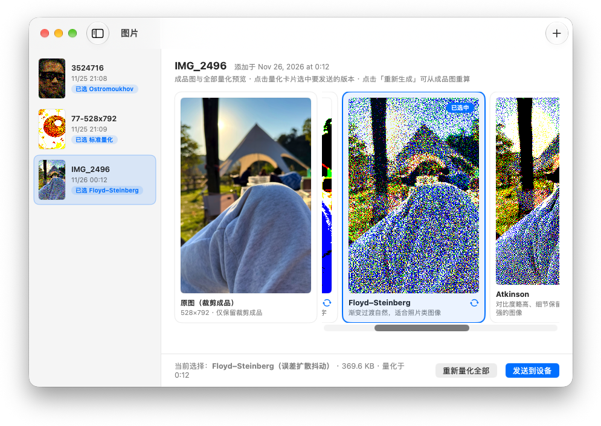

# TodooCard for macOS

TodooCard（T3 528×792 六色电子墨水屏蓝牙卡片）的 macOS 客户端：管理图片库、裁剪成品、生成多种量化预览，并通过蓝牙发送到卡片显示。



## 功能特性

- **图片库**：多图添加、裁剪入库（仅保留 528×792 裁剪成品）、持久化存储，重启不丢失
- **量化预览**：同一成品图生成多个量化变体，卡片式对比——
  - 标准量化（无抖动）：色块干净、边缘锐利
  - Floyd–Steinberg：误差扩散抖动，渐变自然
  - Atkinson：误差扩散抖动，对比度更高
  - Ostromoukhov：可变系数误差扩散（蓝噪声频谱），纹理均匀
- **选中发送**：点击变体卡选中要发送的版本（随条目记忆），底部一键发送到设备，全程进度弹窗
- **重新量化**：单变体「重新生成」或「重新量化全部」；缺失的量化图启动时自动补建
- **设备管理**：扫描/配对附近的 TodooCard，设置默认发送设备

## 环境要求

| 依赖 | 版本 |
| --- | --- |
| macOS | 13.0+ |
| Xcode / Swift | 15+ / 5.10 |
| [XcodeGen](https://github.com/yonaskolb/XcodeGen) | `brew install xcodegen`（重新生成工程用） |

## 编译与运行

```bash
# 1. 首次构建 / 增删源文件后：重新生成 Xcode 工程
cd macos && xcodegen generate && cd ..

# 2. 构建
xcodebuild -project macos/TodooCardMacApp.xcodeproj \
  -scheme TodooCardMacApp -destination 'platform=macOS' build

# 3. 运行测试（35 个用例）
xcodebuild -project macos/TodooCardMacApp.xcodeproj \
  -scheme TodooCardMacApp -destination 'platform=macOS' test

# 4. 启动应用（也可直接用 Xcode 打开 macos/TodooCardMacApp.xcodeproj ⌘R）
open "$(ls -td ~/Library/Developer/Xcode/DerivedData/TodooCardMacApp-*/Build/Products/Debug/TodooCardMacApp.app | head -1)"
```

> 应用数据在 `~/Library/Application Support/TodooCardMacApp/ImageLibrary/`：`manifest.json` 存条目元数据，每个条目一个 UUID 目录（`processed.png` 成品 + 各变体量化图）。

## 项目结构

```
macos/
├── App/                    # 入口（窗口、默认尺寸）
├── Models/                 # LibraryImage、QuantizedVariant（变体注册表）、配置
├── Services/               # ImageLibrary（持久化）、ImageProcessor（裁剪/量化）、
│                           # QuantizationAlgorithm（抖动算法）、蓝牙传输、设备扫描
├── Views/                  # 图片页（库列表 + 量化预览详情）、设备页、裁剪、传输进度
├── Tests/                  # 单元测试（量化算法、图片库、payload 编码、滚轮换算等）
├── Support/                # Info.plist、应用图标（Assets.xcassets）
└── project.yml             # XcodeGen 工程定义
openspec/                   # 规格驱动开发：spec 主库 + change 提案/归档
docs/                       # 技术文档、设计稿、提示词指南（见下方文档索引）
```

## 如何新增量化算法

量化管线是**注册表数据驱动**的：新增算法 = 注册表追加一项 + 实现一个扩散核，UI 卡片、持久化、选中/发送、缺失自动补建全部自动生效。

完整步骤、代码骨架、输出约束（六色调色板 / 528×792 / 确定性）与验收清单见 **`docs/ai-coding-prompts.md`**（含「新增误差扩散抖动算法」与「接入 AI 处理方式」两套模板）。规模较大的改动请先走下方 OpenSpec 提案流程。

## 如何贡献代码

1. **Fork + 分支**：从 `main` 拉出功能分支（如 `feat/ordered-dither`）。
2. **大改动先提规格**：涉及可观察行为变化（新处理方式、数据模型、UI 交互）时走 OpenSpec 流程，保持 `openspec/specs/` 与实现一致：
   ```bash
   openspec new change "<kebab-case-name>"   # 或使用 /openspec-propose
   # 编辑 proposal / specs delta / design / tasks → 实现 → 同步主 spec → 归档
   ```
3. **提交信息**：Conventional Commits，中文描述（仓库现有风格：`feat:` / `fix:` / `docs:` / `chore:`），正文说明动机与要点。
4. **完成定义（PR 前自查）**：
   - [ ] `xcodebuild ... test` 全绿，新行为带测试
   - [ ] 不改持久化文件命名（`quantized.png`/`dithered.png` 等存量文件勿重命名）与 `manifest.json` 字段语义；新增字段必须可选、向后兼容
   - [ ] 不动蓝牙传输协议与 payload 编码（`ControllerPayloadTests` 约束）
   - [ ] 量化输出满足六色调色板、528×792、确定性
   - [ ] 如改了 `project.yml` 或增删源文件，重新 `xcodegen generate` 并提交 `project.pbxproj`
5. **PR 说明**：动机 / 主要改动 / 验证方式（测试 + 运行时走查），关联对应 OpenSpec change。

## 文档索引

| 文档 | 内容 |
| --- | --- |
| `docs/TECHNICAL_DOCUMENTATION.md` | TodooCard 命令行工具链（配对/探测/打包/发送）技术细节 |
| `docs/architecture-diagram.md` | 架构图 |
| `docs/image-page-ui-design.html` | 图片页 UI 设计稿（浏览器打开，含交互演示） |
| `docs/ai-image-quantization-prompts.md` | 图像 AI 量化提示词指南（生成适合六色墨水屏的图） |
| `docs/ai-coding-prompts.md` | 编码 AI 提示词指南（新增算法 / 接入 AI 处理的需求模板） |

## License

（待补充）
