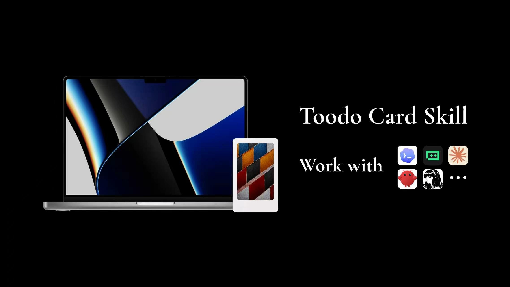
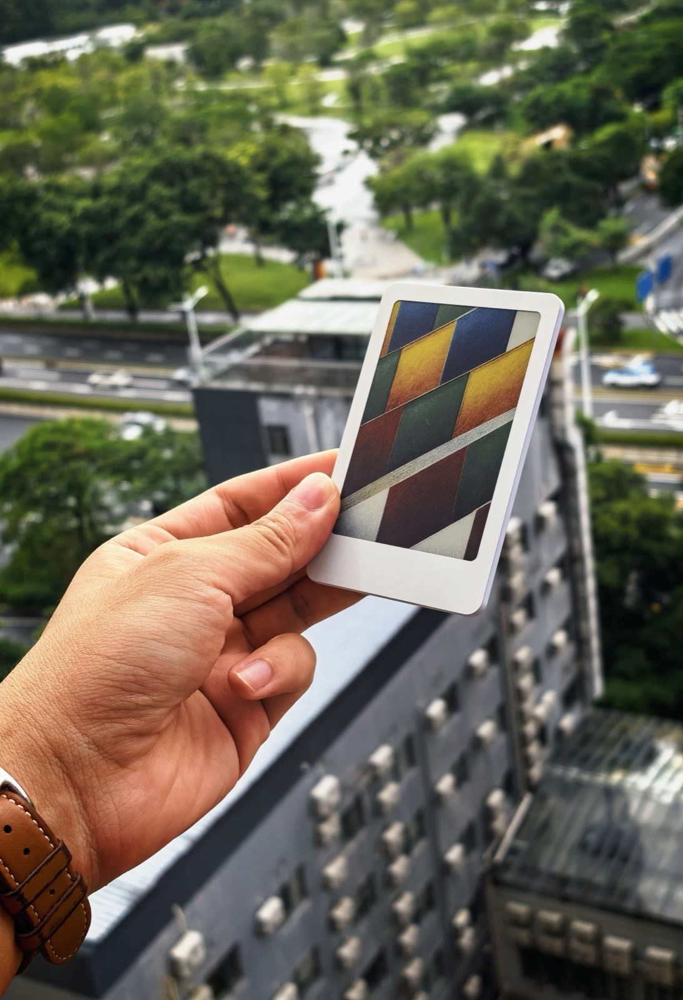
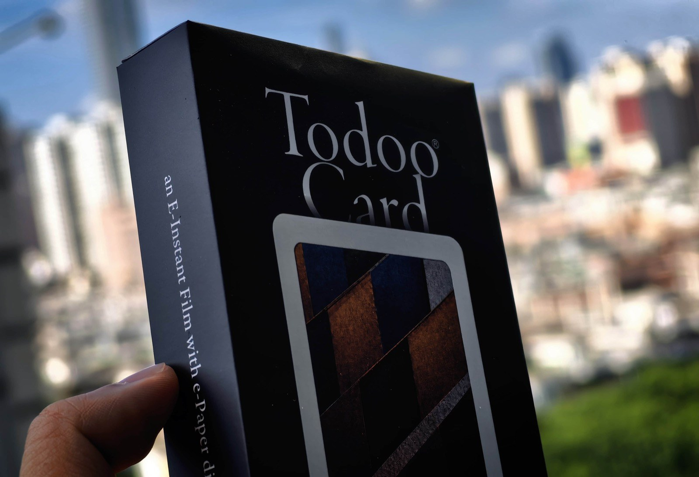
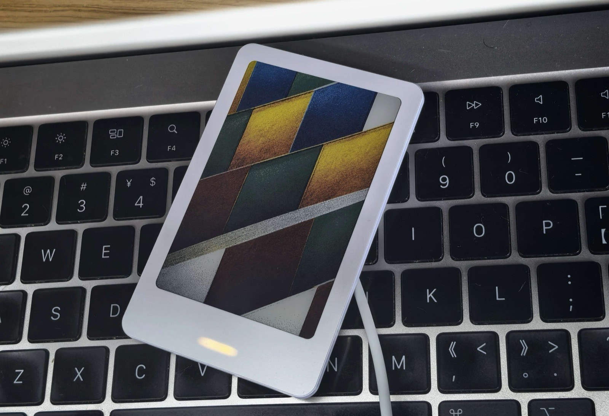
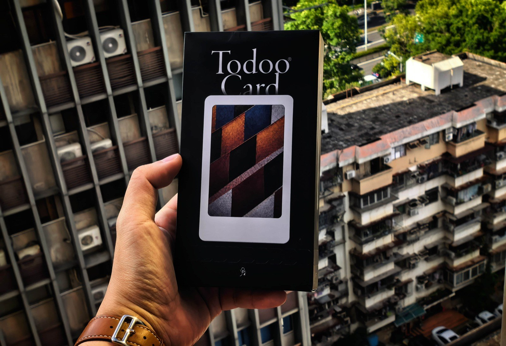
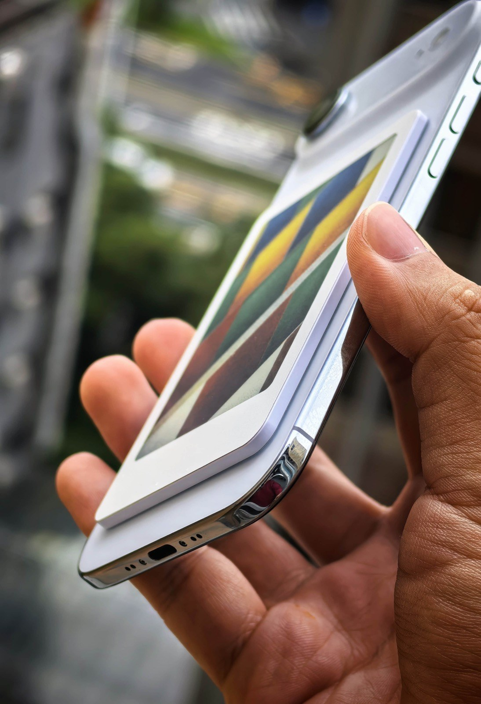
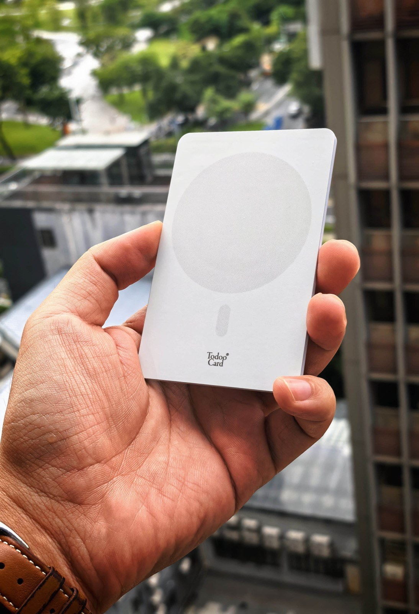

# TodooCard Skills

TodooCard 电子拍立得的开放 Skill。

TodooCard Skills 可用于在 macOS 上安全配对、校验、探测并发送图片到 TodooCard 电子纸卡片。



## 适合做什么

- 把 JPG、PNG、HEIC 图片转换为 TodooCard 可用的六色电子纸 payload。
- 在发送前校验 payload 尺寸、QuickLZ 包装和文件结构。
- 针对 v157+ 自动使用 2 KB QuickLZ level-3 压缩、32 包 Flash 落盘确认和按块续传；旧固件自动回退兼容格式。
- 扫描附近兼容的 BLE 电子纸卡片。
- 按最新固件协议，通过实体按键开启的 60 秒窗口与 Mac 建立系统配对。
- 按指定设备 UUID 探测设备。
- 读取 v165+ 固件保留的图片 ACK 诊断，区分乱序、Flash 写入失败和回读失败。
- 在用户确认后，将图片发送到指定 TodooCard 设备。
- 处理屏幕倒装、图片横竖方向异常、颜色渲染检查等问题。

## 安装方式

在 Mac 上打开支持本地 Skills 的 AI Agent 客户端，告诉它：

```text
请安装这个 TodooCard Skills：https://github.com/Sunbelife/TodooCard_Skills
```

安装完成后，重新打开一个任务或重启客户端，让它重新加载本地 Skills。

## 使用示例

在 Codex 里可以这样说：

```text
Use $todoocard-skills to securely pair my Mac with this TodooCard, then prepare and verify my image before sending.
```

或者直接用中文：

```text
用 TodooCard Skills 帮我把这张图片传到卡片上，先生成并校验 payload，不要直接发送。
```

## 推荐流程

1. 先列出附近设备：

   ```bash
   scripts/prepare_and_send.sh --list
   ```

2. 如果设备显示 `secure=yes` 且这台 Mac 尚未配对，先运行配对等待命令：

   ```bash
   scripts/prepare_and_send.sh --pair --device-id UUID
   ```

   当前 v167 固件长按设备背面按钮 5 秒（v152 以前的安全固件为 10 秒）；正面灯快闪后，脚本只会在广播确认
   `pairing=open` 时连接。配对窗口最长 60 秒。如 macOS 弹出系统配对提示，
   请确认配对。

3. 配对完成后，用同一个准确 UUID 探测设备：

   ```bash
   scripts/prepare_and_send.sh --probe --device-id UUID
   ```

4. 只准备和校验图片，不发送到设备：

   ```bash
   scripts/prepare_and_send.sh --input /path/image.heic
   ```

5. 确认目标 UUID、图片方向和预览结果都正确后，再显式发送：

   ```bash
   scripts/prepare_and_send.sh --input /path/image.heic --device-id UUID --send
   ```

## 最新固件传输适配

- 当前适配 v167（广播原始版本 `0xA7`）。v167 的图片协议沿用 v157+ 的可靠传输方式。
- v157（`0x9D`）及以上优先使用与小程序一致的 2 KB 独立 QuickLZ level-3 数据块；压缩无收益时自动改用 RAW。
- 每发送 32 个 BLE 数据块等待一次设备外部 Flash 写入与回读确认；设备返回缺块位置时只从该位置续传。
- v165（`0xA5`）及以上会在探测或传输失败时读取保留诊断，显示 ACK 生成、接受、拒绝次数及最后块位置。
- v166（`0xA6`）及以上可能在传输结束或卡住后主动断连/重启以恢复广播。Skills 不会把断连误判为成功，只有收到 `0x05 0x08` 显影确认才报告完成。
- 设备处于 OTA 恢复模式（广播能力位 `0x08`）时拒绝传图，避免覆盖固件修复路径。

本次实现的 v157+ QuickLZ 结果已和小程序的编码器做过逐字节一致性验证，同时保留旧固件的 64 字节 stored 格式作为自动回退。

## 固定方向要求

调用方始终提供正向原图，并把它视为正确方向。TodooCard/T3 528x792（`0x134C`）
的面板校准由底层 `todoocard-correct` 自动处理，不允许通过
`--screen-orientation` 覆盖，也不要在上层重复旋转或镜像。

如果只有源图横竖方向不对，可以先加：

```bash
--rotate-right-90
```

源图纠偏完成后，底层标准面板校准仍会自动执行。

## 安全提醒

- 发送前必须确认准确的设备 UUID，不要只按设备名选择。
- `--pair` 只允许在实体按键开启的配对窗口内连接；普通 BLE 连接不代表配对成功，必须以加密特征读取成功为准。
- 新设备配对窗口开启时，`--probe` 和 `--send` 会拒绝运行，避免把配对与传图混在一起。
- OTA 恢复模式下拒绝传图；先通过受控固件流程恢复设备。
- `--send` 是显式开关；发送成功后，卡片画面会被新图片替换。
- 不建议发送外部来源的 `.bin` 或 `.protocol.qlz` 文件，应始终用本 skill 内置脚本生成并校验。
- 本地图片和临时 payload 视为隐私文件，不要上传到外部服务。
- 输入图片限制为 100 MB 和 50 megapixels 以内。

## 产品图片

更多产品介绍可以看：[p.todoo.tech](https://p.todoo.tech)













## 购买链接

购买 TodooCard：[wxmpurl.cn/l9UUcyEDIrs](https://wxmpurl.cn/l9UUcyEDIrs)
